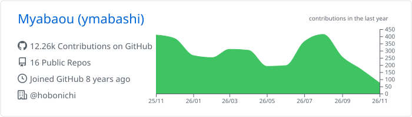
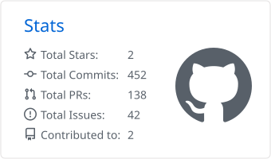
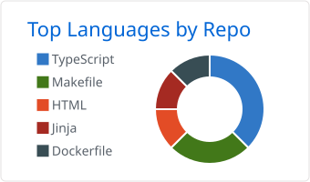

### Hi there, I'm Myabaou 👋

Infrastructure engineer building things on AWS with Terraform / CDK for Terraform.

- 🏢 Working at [@hobonichi](https://github.com/hobonichi)
- ☁️ AWS / Terraform / CDKTF / GitHub Actions
- ✍️ Writing tech notes on [Zenn](https://zenn.dev/myabaou)

 

#### 🛠 Tech Stack

#### 📊 GitHub Stats

<picture>
  <source media="(prefers-color-scheme: dark)" srcset="./profile-summary-card-output/github_dark/0-profile-details.svg">
  
</picture>

<picture>
  <source media="(prefers-color-scheme: dark)" srcset="./profile-summary-card-output/github_dark/3-stats.svg">
  
</picture>
<picture>
  <source media="(prefers-color-scheme: dark)" srcset="./profile-summary-card-output/github_dark/1-repos-per-language.svg">
  
</picture>

#### ✍️ Latest Zenn Articles

<!-- BLOG-POST-LIST:START -->
- [[GitHubActions]CDKTFの実行結果に応じてLablesを付与する](https://zenn.dev/myabaou/articles/gha_cdktf_labels)
- [MWAA の制御のスクリプト化](https://zenn.dev/goals_techblog/articles/751e10703eab5b)
- [[GitHub Actions] Terraform実行基盤の共通化](https://zenn.dev/goals_techblog/articles/2727bfd3b77dd2)
- [[GitHub Actions] ymlに対してのフォーマットがきかない](https://zenn.dev/goals_techblog/articles/269f48d6a56054)
- [【ECS】FargateSpotを設定しようとしたらエラー](https://zenn.dev/goals_techblog/articles/52bc45e1674dd7)
<!-- BLOG-POST-LIST:END -->

➡️ [All articles on Zenn](https://zenn.dev/myabaou)

#### 🐍 Contributions

<picture>
  <source media="(prefers-color-scheme: dark)" srcset="https://raw.githubusercontent.com/Myabaou/Myabaou/output/github-snake-dark.svg">
  
</picture>
